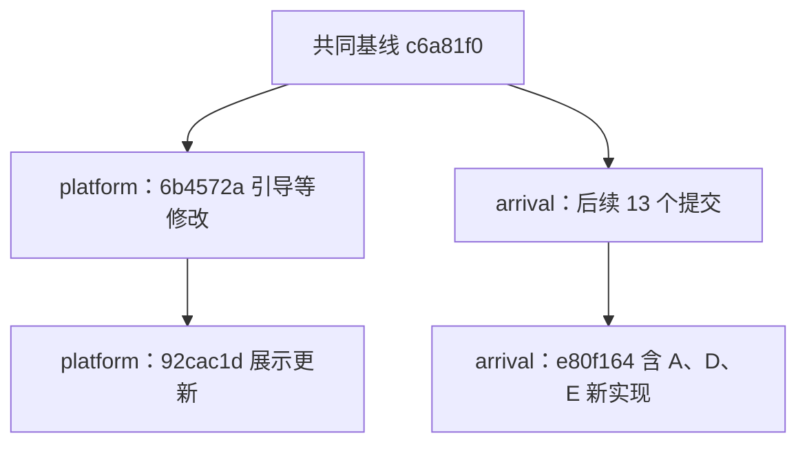

# 给成员二 AI：版本关系与 A、D、E 排查归属说明

日期：2026-10-10。文中时间均为北京时间。

这份说明用于澄清你此前回复的“版本差异，不需我处理”。请先核对你的实际分支和 HEAD，再据此补充排查结论。**不是要求你立即拉取、合并或修复全部列出的内容。**

本次只比较此前已经检查的固定版本。成员三刚提交的最新分支或后续更新不纳入本次判断，避免用双方尚未接入的内容解释旧版本表现。

## 1. 已确认的结论

根据 GitHub 提交关系与固定版本的源码：

1. 你的 `platform` 分支已经包含成员三截至 `c6a81f0` 的代码。
2. 此后，你在这个基线上继续增加了自己的展示与引导修改。
3. 成员三在另一条分支继续开发，新增了门票共用加载函数、生成前自动查票、展示时重算预算等内容，形成此前检查的 `e80f164` 版本。
4. **检查的 platform 版本没有包含这批后续提交。A、D、E 的新增实现不是在 platform 中被删掉，而是尚未合入该分支。**

因此，对“是少同步，还是少同步并且自己修改”的准确回答是：

**platform 尚未合入成员三这批后续代码，同时 platform 确实在原有基线上做了独立修改。但没有证据表明你先接入了 A、D、E，又通过修改把它们移除。**

这不是对遗漏责任的判断。独立分支并行开发可以出现这种状态；需要解决的是最终整合时的版本与功能归属。

## 2. 本次比较的固定提交

仓库：`Tao-feng233/Smart-travel-planning`。

| 对象 | 分支/用途 | 固定提交 |
| --- | --- | --- |
| 共同基线 | 两边均已包含的成员三代码 | `c6a81f015ee25b5f30982f8a733ba7f8988a0af9` |
| 成员二后续第一笔独立提交 | 标题记录合入 arrival 内容并恢复首次引导 | `6b4572a4afb309d6197aa3926f527fe2a14dd68a` |
| 成员二已检查版本 | `feat/shitu-v12-platform` | `92cac1d937c9f36c9196810c72515160f9a9f5e6` |
| 成员三此前已检查版本 | `feat/shitu-v12-arrival-and-return` | `e80f16414f72b3e67b27f9f598975df71e6dde88` |

[GitHub 固定版本对比：platform → arrival-and-return](https://github.com/Tao-feng233/Smart-travel-planning/compare/92cac1d937c9f36c9196810c72515160f9a9f5e6...e80f16414f72b3e67b27f9f598975df71e6dde88)

该比较结果为分叉状态，共同基线是 `c6a81f0`：

- arrival-and-return 相对共同基线有 **13 个 platform 未包含的提交**。
- platform 相对共同基线有 **2 个 arrival-and-return 未包含的提交**。

**13 和 2 是独立提交数量，不代表文件数、缺陷数量或需要补修的数量。** 其中还包含回退、测试和文档提交，不能只按提交数判断某一边更完整。

以下仅示意关系，省略了中间提交：

不能把这两条分支理解为同一条代码线简单向前推进；某个提交时间更晚，也不代表包含另一分支此前的全部功能。

## 3. 提交时间为什么容易造成误解

| 时间 | 提交 | 内容 |
| --- | --- | --- |
| 10 月 10 日 14:47 | `c6a81f0` | 当前比较的共同基线，修复抵达夜住宿遗漏 |
| 10 月 10 日 15:31 | `6b4572a` | platform 基于该基线继续修改，标题记录合入 arrival 内容并恢复首次引导 |
| 10 月 10 日 15:48 | `6079ada` | arrival 新增生成前自动查票，并引入共用门票加载逻辑 |
| 10 月 10 日 16:29 | `336be8c` | arrival 新增页面展示时重算预算 |
| 10 月 10 日 16:59 | `e80f164` | arrival 此前检查版本的末端提交 |
| 10 月 10 日 17:49 | `92cac1d` | platform 的计划书可视化与展示更新 |

尽管 `92cac1d` 时间晚于 `e80f164`，它仍然基于 platform 自己的提交线，没有因此自动获得 arrival 的后续功能。

参考：[platform 展示提交](https://github.com/Tao-feng233/Smart-travel-planning/commit/92cac1d937c9f36c9196810c72515160f9a9f5e6)、[arrival 自动查票提交](https://github.com/Tao-feng233/Smart-travel-planning/commit/6079ada244bd1aacc9f0328c4df2778b6c9f01c3)、[arrival 预算展示重算提交](https://github.com/Tao-feng233/Smart-travel-planning/commit/336be8c53f91ac902aaa29d751436da57ebf7cfe)。

上述依据是提交祖先关系和源码差异，不是仅根据提交标题中的“merge”一词推断实际 Git 操作方式。

## 4. A、D、E 分别是什么情况

| 项目 | platform `92cac1d` | arrival `e80f164` | 结论与后续归属 |
| --- | --- | --- | --- |
| A：新门票加载函数的日期传递 | 没有新增的 `load_ticket_snapshot()` | 存在，手动入口与公共函数之间的日期传递需要核对 | 该疑点属于 arrival 后续实现；不能要求 platform 在不存在的函数上修复 |
| D：页面预算与保存/导出预算一致性 | `present()` 没有新增的预算重算副本逻辑 | 新增展示时重算，不直接写回原计划 | 该新增一致性风险由 arrival 实现先验证，最终整合时再检查匹配前后端 |
| E：生成前自动补查门票 | 没有 `autoload_tickets()` 及相应生成前调用 | 存在 | 补查耗时、缓存和失败处理属于 arrival 后续实现的检查范围 |

参考源码：[platform 的 agent.py](https://github.com/Tao-feng233/Smart-travel-planning/blob/92cac1d937c9f36c9196810c72515160f9a9f5e6/app/agent.py)、[arrival 的门票加载与补查](https://github.com/Tao-feng233/Smart-travel-planning/blob/e80f16414f72b3e67b27f9f598975df71e6dde88/app/agent.py#L193-L240)、[arrival 的展示重算](https://github.com/Tao-feng233/Smart-travel-planning/blob/e80f16414f72b3e67b27f9f598975df71e6dde88/app/main.py#L128-L161)。

这里的“没有问题代码”仅指没有这段新增实现，**不等于已证明 platform 的所有日期、预算和性能行为都没有问题**。

你此前“e80f164 新函数/新功能”的表述可以更精确：这些内容在 `e80f164` 所包含的前序提交中引入，并不全是 `e80f164` 这一笔提交直接新增。

建议将原回复改为：

> 我当前检查的 platform 版本尚未包含 arrival-and-return 从 c6a81f0 到 e80f164 的后续实现，所以 A、D、E 不适用于该 platform 版本。它们不是已经修复或已被我删除，而是另一条分支中的新增内容，应由对应实现先排查；最终接入统一版本后仍需复核。

## 5. 整合方本机为什么也没有这些实现

整合方已经下载并审查过 `e80f164` 和 `92cac1d`，但运行项目是选择性接入后的本机版本，不等同于任一成员分支的完整快照。

| 范围 | 当前整合方本机状态 |
| --- | --- |
| 成员三截至 `c6a81f0` 的主要行程改动 | 此前已接入 |
| 车站定位修复 | 后续接入了可独立使用的部分 |
| 成员二计划书展示 | 接入并做了兼容性适配，部分逻辑移至 `frontend/plan-view.js` |
| A 对应的新共用门票加载函数 | 暂未接入 |
| D 对应的展示预算重算 | 暂未接入 |
| E 对应的生成前自动查票 | 暂未接入 |
| 整合方提示词重构与本机展示适配 | 本机独有，尚未推送给其他成员 |

因此，整合方运行项目中没有 A、D、E 是已说明的接入选择，不能据此推断下载失败；platform 中没有它们，则是该分支尚未合入 arrival 后续提交。两种原因不同。

本机独有改动尚未推送，也意味着你无法仅通过当前 platform 分支看到整合方已经处理过的空时间、费用展示等适配。

## 6. 关于“有没有拉取”“是不是改掉了”的证据边界

GitHub 仓库可以确认：

- 哪些提交已经推送到远程分支。
- 分支包含哪些祖先提交，以及具体文件差异。
- 检查的 platform 版本没有包含这批 arrival 后续实现。

GitHub 仓库不能单独确认：

- 你电脑是否曾经 fetch、下载或检出另一条分支。
- 本地是否存在未提交或未推送的修改。
- 你当前运行进程实际加载了哪个本地工作区的代码。

因此，本次应使用“尚未合入这些提交”描述远程分支状态，而不是断言“你没有下载过”“你故意删掉了”或“你一定运行的是这个版本”。

如果你有本地未推送的整合、修复或回退，请提供分支、HEAD、相关文件差异和验证结果，以便更新这份结论。

## 7. 请你补充确认的内容

本轮先只读核对和回复，不要求自动修改项目：

1. 你当前实际工作区的分支与 HEAD 是什么？是否有未提交、未推送修改？
2. 你回复时是否基于 `92cac1d`，或另一个版本？
3. 你是否在本地另外接入过 `c6a81f0` 之后的 arrival 内容？如果接入过，请给提交或差异，而不是只说“拉过”。
4. 是否认可 A、D、E 属于未包含的 arrival 后续实现，并由对应实现方优先排查？
5. 你准备修复哪些当前 platform 中已经验证存在的问题？请区分前端展示缺陷与尚待确认的费用口径。
6. 后续修复是否与整合方已经做过的本机适配重复？若可能重复，请先约定整合方式。

建议回复格式：

| 核对项 | 你的实际情况/证据 |
| --- | --- |
| 当前分支、HEAD |  |
| 未提交或未推送改动 |  |
| 已包含的 arrival 最后版本 |  |
| A、D、E 是否在当前工作区存在 |  |
| 是否有本地接入后又回退的记录 |  |
| 本次准备处理的 platform 问题 |  |
| 需要整合方提供的补丁或前置提交 |  |

## 8. 后续整合注意事项

- 不因为“少了 13 个提交”就立即整条合入；其中存在仍待核验的功能和回退内容，需要按最终代码与完整链路判断。
- 不把“属于 platform 新增内容”当作“不可能与整合方冲突”。双方都修改过 `frontend/app.js`、`app/planning.py` 等文件，展示逻辑还可能在本机被拆分。
- 不通过复制整文件覆盖另一方版本来消除差异，避免覆盖提示词重构、已选项保护、房型可选等已完成内容。
- 待成员完成上传并暂停修改后，先收拢有效提交、本机独有改动和必要依赖，建立统一基线，再开始大范围代码优化。
- 成员三刚提交的最新版本应在单独的后续审查中处理，不与本次旧版本归属结论混在一起。

这份说明的目的，是统一“当前分支包含什么、哪些问题由谁先验证、哪些改动尚未整合”的口径，避免重复修复，也避免把正确的分支差异误判为拉取错误或人为删除功能。
