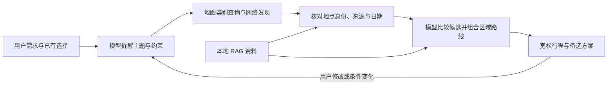

# 识途：企业场景定位与改造审查

审查日期：2026-10-12。依据当前本地源码、项目说明和官方接口资料进行静态审查。本次仅新增审查文档，未修改业务代码、提示词或正式汇报文档；未进行生产压测、商业授权审计或新的真实用户效果实验。

## 1. 核心判断

建议将项目定位为**面向自由行用户的旅行决策与行程规划助手**，企业场景可以是旅游平台的行程规划入口或旅行顾问的方案辅助工作台。

它应解决的问题是：用户需要跨多个来源寻找地点、判断哪些地方适合自己、组合顺路的行程，以及在需求变化后重新整理方案。住宿与交通服务于这些决策，交易履约由外部平台完成。

目前更准确的成熟度是：**已有较完整工程基础、可本地演示的规划原型，还没有形成经过真实用户与生产环境验证的企业服务**。差距主要在产品边界、候选数据覆盖、推荐效果验证和部署运维，增加更多框架或数据库不能直接填补这些差距。

现有工程不需要推倒重来。账户与旅行隔离、版本撤销、查询缓存、任务进度、候选 ID 校验、地图坐标核对和资料来源保留都有继续使用的价值。

## 2. 对老师五点意见的判断

### 2.1 时间规划：默认宽松，保留必要约束

老师指出了真实的体验问题，但交通与时间信息仍然有用。

建议区分三类信息：

| 类型 | 例子 | 建议处理 |
| --- | --- | --- |
| 用户明确的固定安排 | 已确认车次、预约入场时段、用户指定的集合时间 | 作为规划约束，变化时重新检查相关安排 |
| 有来源的运营与通行事实 | 开放时间、最晚入场、查询时的交通预计耗时 | 展示来源与适用时间；对明确冲突提醒，未知结果不能当作不可达 |
| 个人节奏与默认估计 | 游玩 90 分钟、午休一小时、每天 09:00 出门 | 作为可改的建议；默认不能据此禁止用户选择地点 |

默认计划建议展示“上午老城区、下午海滨、晚上自由活动”，每半天少量主要活动并保留备选。用户想看详细安排时再展开建议时刻。交通展示“步行约 15 分钟 / 打车约 10 分钟”，不能把查询时的耗时当作未来实时路况保证。

旅游规划的目标也不应是把所有景点压缩到能塞进去。遇到明显过满的安排，应给出“保留核心景点、把另一个作为备选”的取舍，并说明变化。已确认预约、已经购买的交通和用户明确锁定的地点需要保留。

当前代码依据：[daily_schedule.py](D:/AI/项目-新/识途/app/planning/daily_schedule.py:89) 默认 09:00 开始；[engine.py](D:/AI/项目-新/识途/app/planning/engine.py:55) 会依据默认 18:30 检查结束时间；[return_fitting.py](D:/AI/项目-新/识途/app/planning/return_fitting.py:79) 对返程日进行五分钟网格试排与弹性时长压缩。这些能力可用于用户主动请求的详细排程，不宜主导默认体验。

### 2.2 酒店：查询与推荐能够构成完整功能

当前供应商白名单只有查询接口，没有酒店下单、支付、取消或退款接口。[tuniu_policy.py](D:/AI/项目-新/识途/app/integrations/tuniu_policy.py:3) 是直接依据。因此应把已有功能明确称为“住宿查询、比较、加入计划”，选择酒店或房型表示规划意向，不能等同于已经预订。

酒店服务能提供的实际价值包括：

- 推荐适合的住宿区域，并解释前往主要活动与抵达站点是否方便。
- 按入住日期、人数、儿童条件和用户预算比较可查询的酒店或房型。
- 对比“全程住一处”和“中途换酒店”，把换房、行李与接驳成本纳入建议。
- 有真实、适用的供应商入口时提供外部查看入口；没有入口时允许用户自行预订后填写入住信息。

若未来开发预订，必须另行完成真实供应商接入、库存与报价确认、订单状态、支付结果、取消退款及售后流程。当前阶段不需要做一个没有履约能力的模拟交易链路。

### 2.3 数据：问题在覆盖与治理，不能只替换成搜索

当前不是无边界的暴力采集：[collection.py](D:/AI/项目-新/识途/app/knowledge/collection.py:1) 使用显式来源登记表；[public_fetch.py](D:/AI/项目-新/识途/app/knowledge/public_fetch.py:12) 有请求间隔、robots 检查和重定向域名限制。这些措施不能代替商业使用授权，但也不能将现有实现简单描述为毫无限制的抓取。

企业接入应确认来源许可、接口合同、允许的缓存与存储方式，并建立更新、失败处理和字段质量机制。公开页面采集、合作 API、地图 POI 和网络搜索都只是获取手段，不能单凭手段判断可靠性。

**当前更严重的问题是，本地资料名单同时成了景点推荐白名单。**[coverage.py](D:/AI/项目-新/识途/app/knowledge/coverage.py:56) 拒绝未覆盖的城市；[spot_search.py](D:/AI/项目-新/识途/app/travel/spot_search.py:142) 丢弃不在本地名单中的景点。即使地图返回真实地点，也无法正常扩展推荐。

这是此前“只允许已有数据库数据”需求的实现结果。若现在转向开放的企业规划服务，需要明确调整这条产品规则：已核对的外部地点可以加入候选；没有本地 RAG 文档，不应直接等于该地点不存在或不能规划。

### 2.4 “重点放在旅游规划”的具体含义

重点是做好用户需要的取舍和组合：

1. **适合谁**：亲子、老人、少走路、海滨、人文等需求怎样影响推荐。
2. **如何组合**：同区域景点如何成组，怎样减少折返，哪些大景区内部地点一起安排。
3. **住在哪**：怎样在价格、通行、全程稳定住宿和抵达返程地点之间取舍。
4. **如何应变**：晚到、下雨、临时闭馆、想换景点时，怎样保留其他选择并局部修改。
5. **怎么解释**：为什么推荐这套方案，有什么可替代选项，哪些信息尚待确认。

例如用户说“青岛两天，带老人，下午到，住一处，想看海”：一个有价值的结果是抵达日只安排轻松的沿海活动，另一天集中安排相邻区域，提供酒店区域与雨天备选。它不需要提前指定每个景点必须玩多少分钟，也不需要逐顿选好餐厅才能生成草稿。

### 2.5 高铁与飞机：作为抵达和返程条件

用户提出的方向合理。交通信息可以用于首尾日可用时间、站点接驳、住宿区域、早班返程前一晚住宿、行李寄存与跨城方案比较。

建议允许用户直接填写“12 日 14:00 到青岛站”，已有班次查询作为可选入口。查询结果加入计划后应区分“参考班次”“用户已确认”，不要把选择动作表达为购票成功。

铁路 12306 官方声明其未授权第三方平台发售火车票和办理相关业务。项目不应承担铁路下单、代登录或支付；展示班次信息还需要核实数据供应方的授权与使用范围。航空与酒店属于不同的供应商合作场景，不能把铁路声明直接套用于它们。[12306 官方声明](https://mobile.12306.cn/mormhweb/zxdt/202412/t20241211_43192.html)

## 3. 网络搜索怎样用于推荐

**搜索词可以来自需求属性，不需要先知道景点名字。**

用户需求为“青岛两天，亲子，下雨时也能玩”，模型可先形成“青岛亲子室内景点”“青岛博物馆亲子”“青岛海滨轻松游览”等查询方向。搜索用于发现候选与补充资料；地图或供应商接口用于核对地点身份、区域和坐标。

推荐的业务逻辑如下，这是建议方案，当前尚未完整接入开放网络搜索：

可落地的步骤：

- 先按城市、主题和 POI 类别召回，查询少量互补方向；限制查询轮次、候选量和费用。
- 把发现的名称映射到真实地点，依据城市、地址、分店、POI ID 和坐标消除同名歧义；只凭名称相似不能认定是同一家。
- 核对关键事实：开放与预约优先使用景区或文旅官方资料；价格与库存使用适用日期的供应商结果；不把营销文章中的描述当成事实。
- 合并同名及父子景区，按偏好、地理分组和节奏比较。候选多并不表示必须全部游玩。
- 搜索失败、本次无结果、本地无资料、字段缺失要分开提示。证据不足时保留不确定性，不虚构补齐。

高德 POI 接口支持按地点类别、地区和周边条件查询，因此可先按类别发现地点，而非只能输入完整景点名称。[高德 POI 搜索文档](https://lbs.amap.com/api/webservice/guide/api-advanced/newpoisearch)

搜索工具可以限制来源域名与时间范围，但这些筛选并不自动保证网页内容正确；还需要核对内容对应的地点、发布日期和适用日期。[搜索请求参数说明](https://help.tavily.com/articles/7879881576-optimizing-your-query-parameters)

RAG 继续用于提供经过管理的背景、游览特点和有日期范围的公告；它与在线工具互补。网页和检索内容应始终作为事实材料处理，不能改变模型的工具权限或系统规则。

## 4. 当前企业应用的主要缺口

| 优先级 | 已核实的现状 | 企业场景影响 | 建议 |
| --- | --- | --- | --- |
| P0 | 功能覆盖景点、住宿、房型、交通、逐餐选择、天气、排时与审核 | 用户操作多，核心规划价值被逐项填写遮住 | 用少量信息生成第一版；补充信息后渐进细化，允许自行安排与代选 |
| P0 | 景点候选受本地名单限制 | 覆盖范围小，“继续推荐”难以补充真正的新地点 | 让已核对的地图或外部候选进入推荐，本地知识作为增强依据 |
| P0 | 默认时间与用餐窗口参与冲突判定和候选筛除 | 不同节奏的用户被默认值过度约束 | 区分硬约束、用户偏好和系统估计；普通拥挤建议调节，严重冲突才醒目提醒 |
| P0 | 供应商接口均为查询 | “选择”若表达成预订会夸大能力 | 使用查询、比较、规划意向与用户已确认等准确状态 |
| P1 | 预算进入模型上下文，但没有完整费用分配与预算闭环 | 不能证明方案在总预算内 | 先明确每人或全团、包含哪些费用；酒店价位与餐饮消费显式参与筛选，未知费用单列 |
| P1 | 酒店常以当天收尾地点查询，也使用景点几何中心附近的参照点 | 不能据此证明全程最方便；频繁换酒店可能降低体验 | 比较稳定住宿、主要区域通行、到离站与换房成本，默认允许全程住一处 |
| P1 | 已有缓存、模型调用记录与串并行限制，候选还会逐一核对多种通行方式 | 查询链路可能较长，局部修改可能带来额外查询 | 候选先展示；详细通行按需核对；变化只刷新受影响数据，用阶段指标定位瓶颈 |
| P1 | 已有单元测试、少量意图检查与检索样例 | 工程回归不能直接证明推荐质量和实际用户效率 | 建立代表性任务集，分别评价检索、推荐、规划与编辑效果 |
| P2 | 任务、锁和取消状态依赖单进程；Qdrant 当前采用本地模式 | 不能直接扩展为多实例、高可用服务 | 小规模试点先保持单实例；需要扩展时再接共享任务协调与 Qdrant 服务端 |

具体依据：

- [recommendations.py](D:/AI/项目-新/识途/app/agents/recommendations.py:29)：完整需求会进入模型，预算并非完全没有被模型看到；这与程序保证满足预算是两件事。
- [stay_plan.py](D:/AI/项目-新/识途/app/travel/stay_plan.py:586)：逐晚查询传入日期、人数、儿童和 POI；此处没有显式预算价位参数。[plan_output.py](D:/AI/项目-新/识途/app/planning/plan_output.py:262) 主要检查住宿参考费用是否已经超出总预算，不能构成完整总价核算。
- [stay_plan.py](D:/AI/项目-新/识途/app/travel/stay_plan.py:609)：所谓中心查询实际使用离几何中心最近的已选景点名作供应商查询参照，不是直接查询几何中心，更不是计算全程通行最优位置。
- [access.py](D:/AI/项目-新/识途/app/travel/access.py:147)：明确的无路线或当前餐次时间冲突会筛除候选；如果餐次窗口来自默认值，需要重新判断这类筛除是否必要。
- [engine.py](D:/AI/项目-新/识途/app/planning/engine.py:93)：一个起终点会依次查询步行、公交、驾车；[foods.py](D:/AI/项目-新/识途/app/travel/foods.py:585) 对一批餐厅做通行预检查。这里能确认调用结构，但不能据此给出真实延迟占比。
- [storage.py](D:/AI/项目-新/识途/app/persistence/storage.py:366)：已有模型 Token、耗时和成功状态记录；仍需要关联整次规划的阶段、供应商调用与缓存命中，才能定位端到端瓶颈。
- [jobs.py](D:/AI/项目-新/识途/app/application/jobs.py:16)：任务在进程内运行，启动会标记旧任务中断；支持恢复已保存状态，不等于后台任务跨进程自动接续。
- [jobs API](D:/AI/项目-新/识途/app/api/jobs.py:62)：每条 SSE 连接循环查询 SQLite 并等待 0.05 秒。是否需要降低查询频率应由并发测量决定，不能直接视作已经达到生产吞吐目标。

## 5. 企业工程应该补到什么程度

当前已经有密码哈希、会话、CSRF、所有权检查、请求幂等、版本冲突检查、任务停止、查询限额与缓存。不能把它评价为“只有模型接口，没有工程”。例如 [auth.py](D:/AI/项目-新/识途/app/api/auth.py:97) 校验会话与 CSRF，[workspaces.py](D:/AI/项目-新/识途/app/api/workspaces.py:165) 检查重复请求。

后续先围绕一个明确试点补齐以下能力：

1. **质量验证**：晚到、亲子少走路、雨天替换、大景区去重、预算不足、查不到地点等典型任务有可复现的验收结果。先建立几十个覆盖关键场景的样例，不急着扩大功能。
2. **数据维护**：每类数据明确来源、更新时间、有效期、刷新方式和失败状态。地图身份匹配与公告适用范围分别核对；官方来源也可能过期。
3. **性能与成本**：记录首批候选时间、整次规划平均和 P95 耗时、每次规划的模型与供应商调用量、缓存命中、任务失败率。为自动继续与搜索设独立预算，不能只依赖每天 500 次任务限额。
4. **运行与恢复**：明确部署配置、HTTPS、凭据管理、数据备份及恢复演练、日志脱敏和用户数据删除范围。当前不需要为展示企业化一次性引入微服务。
5. **结果可信**：已确认事实、模型建议、查询快照、未知事项分别表达；固定事项变动后提示受影响部分，用户可以查看差异并撤销。

SQLite 当前承担账户、旅行、版本、任务和有限期缓存，小规模单机试点可以先沿用。是否换服务端数据库，应由多实例需求、写入并发与运维目标决定；换数据库本身不能改善推荐质量。

## 6. 建议的实施顺序

### 第一阶段：收缩产品边界

修改状态和文案，明确不承诺交易履约；默认宽松行程、按需展开详细时间。减少生成草稿前的必填项，避免景点、酒店、餐厅必须逐项选完。保留必要硬约束与现有版本编辑能力。

验收：只提供目的地、天数和一个偏好就能得到可讨论的草稿；用户说“其他帮我安排”能使用已有候选形成方案；车票自理、餐饮自理都不阻断规划。

### 第二阶段：补足候选与规划判断

优先开放经核对的地图类别候选，再补有限的网络发现和官方事实核对。改善地理成组、全程住宿区域比较、预算价位与雨天备选。解除本地知识对白名单的绑定时，保留真实地点身份校验。

验收：资料名单外的真实地点经过核对后可参与推荐；晚到、雨天或换景点只调整受影响部分；不会为了凑数量压缩所有活动，也不会把供应商无结果表达成整个城市没有数据。

### 第三阶段：用评估证明效果并补部署

在有限目的地范围内做真实试用，记录上述质量、时延、成本与编辑指标；根据结果再决定共享队列、数据库和部署扩展。性能优化从已测瓶颈入手。

这三阶段可以分别提交，不建议同时重写前端、数据库、所有提示词和排程引擎。

## 7. 面试中值得讲的内容

可以围绕一条完整链路讲：需求识别 → 工具查询 → 候选身份与事实核对 → 推荐与路线组合 → 用户修改 → 版本保存与局部刷新。

对当前项目，一个准确的介绍是：

> 我们做了一个面向自由行场景的旅行规划原型，用模型理解偏好并组合方案，通过 MCP 接入地图、天气和供应商查询，通过 RAG 补充可追溯的旅游资料。它支持候选比较、计划编辑和版本恢复。我们把交易履约放在项目边界之外，当前重点完善候选覆盖、宽松行程和推荐质量验证。

你负责的 MCP、RAG 与数据部分可以讲三个具体取舍：

- 地图和供应商工具负责真实地点与查询时快照，本地 RAG 负责背景与公告，不把知识库当实时库存。
- BGE 中文嵌入通过 FastEmbed 运行，父子块与 BM25、向量、RRF 组合服务于旅游资料检索；选型理由是中文资料适配、部署成本和来源回溯，需要效果实验进一步验证。
- 同名酒店、缺失坐标、查询失败、公告过期都会影响上层规划，因此要在数据边界明确身份、来源和状态，不能把错误结果交给模型猜测。

最有价值的讨论是实际遇到的问题、采用的方案、已有验证和下一步如何验证。公司合作、生产部署、用户规模、转化提升等内容应以真实经历和测量为依据；目前的回归检查不能换算成线上业务成果。

## 8. 当前可作出的结论与限制

- 可以确认：项目已有查询、模型推荐、工具编辑、版本保存与部分审核能力；供应商调用白名单只读；景点扩展受本地覆盖限制；时间和费用存在上述产品边界。
- 不能确认：真实生产性能、商业使用授权是否齐备、用户规划效率提高多少、完整推荐质量是否达标。
- 本文属于产品与工程方案审查，不是已完成的改造清单，也不是对所有源码逐行进行的安全或缺陷审计。
