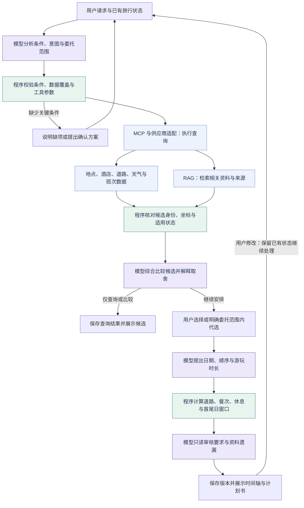
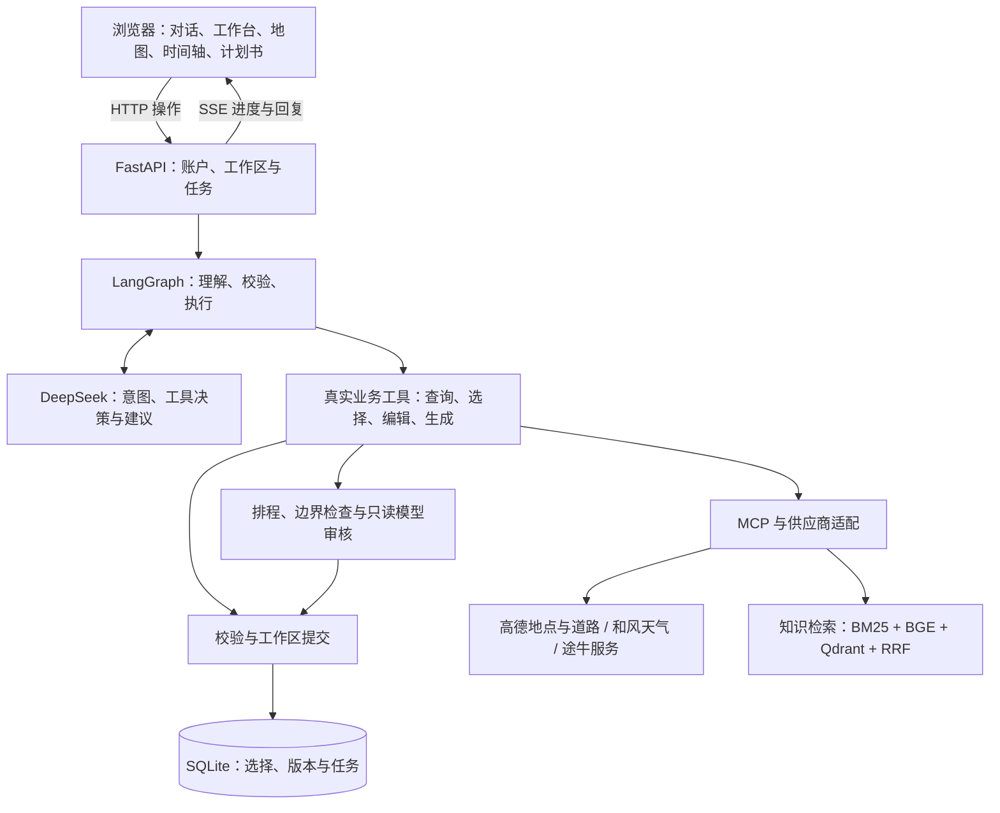
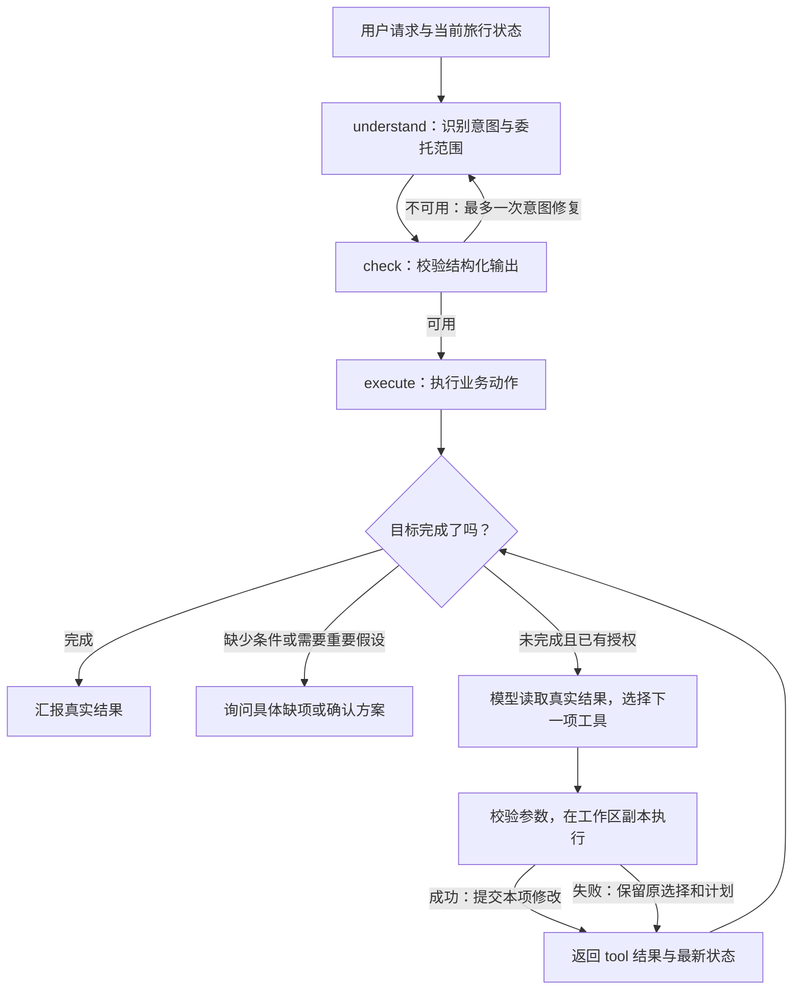
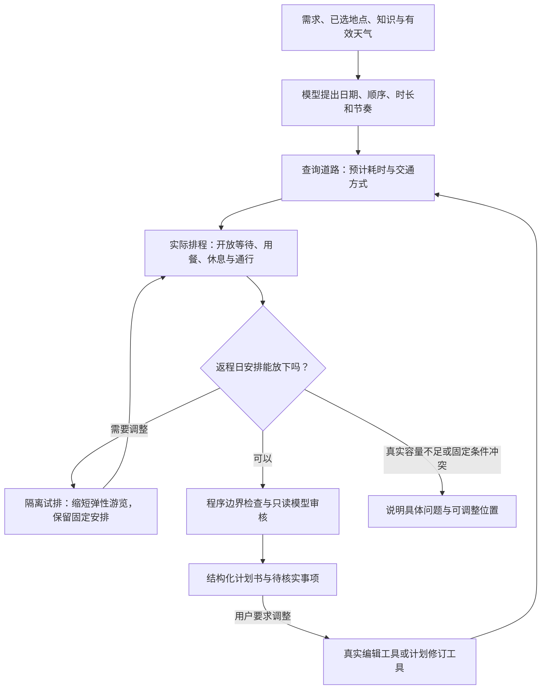

# 识途 · AI 旅行规划智能体——项目汇报

更新日期：2026-10-12

---

## 第一部分：项目介绍与目的

### 1.1 项目背景

自由行规划需要同时查阅景点介绍、酒店位置、交通班次、地图路线、餐饮和天气。信息分散在多个平台，用户不仅要查“有什么”，还要判断“适不适合我”“能不能顺路”“当天时间够不够”。当出发或返程时间变化时，原有安排往往还需要重新核对。

用户已经可以使用豆包、DeepSeek 等通用 AI 应用辅助制定旅游计划。这类应用能够理解自然语言、整理建议，并可结合联网检索取得外部信息。但旅行规划对信息来源和适用时间有较高要求：模型已有知识的更新受训练资料与更新周期影响，难以单独确认某天的开放、价格、预约和交通情况；联网搜索虽然可以取得较新的内容，结果中仍可能混有推广文章、重复转载、过期攻略和缺少日期依据的描述，信息数量增加并不等于规划依据更可靠。

**本项目的制作动机，是为模型提供更有依据的旅行信息，并将这些信息接入实际决策与排程。**识途优先接入文旅部门、景区等公开资料，以及高德、和风、途牛等数据服务的结构化查询结果；保留来源、查询时间、适用范围和未知状态，再交给模型分析用户条件与候选取舍。对于已取得的地点、班次和道路数据，程序进一步核对位置、时间和衔接条件。

识途将信息取得、来源核对和行程检查组织为专门的旅行规划流程，目标是提高规划依据的可追溯性与实际适用性。官方资料与接口结果仍需核对日期和使用条件。**一份看起来完整的攻略，需要有可追溯的资料和可核对的安排作为支撑。**

### 1.2 项目简介

**识途**是一个面向自由行用户的交互式 AI 旅行规划系统。它将需求理解、旅游资料检索、数据接口调用和结构化行程生成连接起来，让用户能够在对话中逐步比较、选择和调整。

用户可以完成“确定目的地 → 比较景点 → 选择住宿 → 安排交通与餐饮 → 生成计划书”，也可以直接提出当前最关心的问题。工作台步骤提供引导，用户仍可查询其他内容，或选择自行安排部分事项。

系统输出包括每日建议时间表、交通方式与预计耗时、住宿和餐饮选择、费用参考、天气信息，以及出发前待办。资料和查询结果保留来源；未知或估算内容明确标注。

### 1.3 项目目标

**核心问题：让 AI 旅游推荐更接近实际决策和出行准备。**

例如，规划“青岛三日游”时，仅列出几个景点还不够：

- 景点开放、门票和预约要求是否有依据？当前资料能否适用于出游当天？
- 住宿到景点、景点到餐厅之间需要多久？是否存在明显折返？
- 中午或下午才抵达时，首日安排是否仍有足够时间？
- 预算中哪些来自查询报价，哪些只是参考，哪些尚未取得数据？
- 用户想放慢节奏或调整一天的安排时，如何保留已选内容继续修改？

识途的目标是：**将来源明确的数据、模型的理解与比较能力、用户决定和程序校验连接起来，形成可持续调整的旅行计划。**

模型主要分析目的地、日期、天数、偏好、同行需求与已有选择，比较查到的景点、住宿和餐饮候选，并提出活动组合及安排建议。日期、班次、坐标和结构化固定要求进入程序查询与排程；预算、体力和体验偏好同时供模型参考。当前预算参与参考比较和费用展示，完整总预算优化仍待完善。

具体目标分为三层：

1. **数据可信、依据可追溯**：优先使用官方知识资料和接口返回结果，保留来源与查询时间，区分事实、建议和未知。
2. **交互完整、决策可调整**：支持比较、替换、跳过和自然语言修改，保留用户已有选择。
3. **计划便于执行与复核**：将日期、活动、道路耗时、休息和待办组织成结构化计划书；对尚未核实的条件保留草稿说明，不承诺出游当天一定可行。

---

## 第二部分：项目展示

### 2.1 整体界面

识途是一个 Web 应用，通过浏览器使用。界面主要分为两栏：

- **左侧对话区**：描述旅行需求、询问原因、提出修改；查看处理进度、具体问题和修改入口。
- **右侧工作台**：展示景点、酒店、交通、餐饮、天气、地图与计划书，便于比较和选择。

此外，旅行时间轴展示当前建议安排、出行方式和预计耗时。每次查询与选择围绕独立的旅行工作区保存，便于回来继续规划。

### 2.2 核心业务逻辑

业务流程围绕“理解需求—取得依据—比较候选—计算安排—持续修改”展开。模型在流程中承担分析与决策建议，工具负责获取数据，程序负责校验、排程与状态提交。



*图 1：识途的核心业务逻辑，包含候选查询与完整规划两类结果。紫色节点表示模型参与的分析、比较、提案与审核；绿色节点表示程序校验与时间计算；蓝色节点表示工具查询及知识检索。模型的工具请求由后端校验和执行，结果返回后再供模型判断。*

以“青岛两日游、两位成人、偏好海滨慢游”为例，各阶段承担的职责如下：

1. **分析用户条件与目标**：模型结合本轮消息和已有旅行状态识别目的地、日期、天数、同行需求与偏好，判断当前是查询、比较、修改还是委托安排。已有明确条件继续使用，关键缺项需要补充。
2. **组织数据查询与资料检索**：后端按动作确定查询范围，通过 MCP 与供应商接口取得真实候选，使用 RAG 补充景点特色及适用说明；程序核对候选身份、坐标、来源与日期状态。
3. **综合比较并提出推荐**：模型读取用户条件与候选资料，在真实候选中比较体验、位置、交通、评分及已有费用参考，给出推荐顺序和理由。住宿结合每天收尾位置与入住条件，餐饮结合餐次、附近活动与口味。
4. **保存选择并形成日程提案**：用户可以自行选择、替换或跳过；明确委托且条件齐全时，模型可通过业务工具补齐授权范围内的选择，再提出游玩日期、顺序、时长和休息节奏。查询本身不代表用户授权代选。
5. **计算、核对与修订**：程序将道路、用餐、休息、开放等待和首尾日可用窗口纳入实际排程，必要时调整可变安排；模型审核用户要求与资料遗漏，输出结构化计划书。后续修改基于已有状态继续进行，每项编辑成功后提交，失败保留原有有效结果。

**模型、数据与程序各自的作用：**

| 业务环节 | 数据与程序提供什么 | 模型承担什么 |
|---|---|---|
| 条件分析 | 当前需求、对话与选择状态；字段与权限校验 | 识别用户目标，提取条件，判断需要查询或修改的内容 |
| 景点推荐 | 已覆盖地点、坐标、资料、评分与费用参考 | 结合天数、偏好、同行需求和有效天气比较组合及备选 |
| 住宿推荐 | 入住日期、人数、当天收尾位置、酒店候选与道路 | 比较位置、通行及已有报价信息，说明适合哪晚行程 |
| 餐饮推荐 | 餐次、活动或住宿参照点、餐厅资料与通行检查 | 结合口味、位置、评分和参考人均说明取舍 |
| 时间安排 | 已选地点、真实道路、固定班次与可用窗口 | 提出日期、顺序、体验范围和合理停留时长 |
| 计划复核 | 已生成日程、校验结果与来源 | 检查用户要求遗漏、事实与建议混淆及明显风险 |

这些信息对系统的作用不同：日期、人数和坐标可以直接进入查询与计算；体验偏好和一般同行备注主要帮助模型判断；预算目前用于参考比较与费用展示，尚不保证完整行程不超支。

### 2.3 计划书内容

最终计划书主要包括：

- **旅行条件**：目的地、日期、天数、人数、预算与旅行节奏。
- **已选住宿**：酒店位置、逐晚选择和房型信息（如有）；选定不代表已经预订。
- **用餐安排**：餐厅选择或自行安排，保留日期与餐次。
- **往返交通**：已选班次或自驾、自行安排的说明；未知抵达时间不会假定为全天可用。
- **每日安排**：活动顺序、建议起止时间、游览时长、午休与机动时间，以及交通方式和预计耗时。
- **费用参考与未知费用**：已有报价、参考估算和待核实项目分别展示，不将缺失费用当作零。
- **天气**：展示接口实际覆盖的预报日期；当前预警不等于未来出游日预警。
- **出发前待办与风险**：预约、开放、报价、交通及入住条件等需要进一步确认的事项。
- **携带建议**：结合已取得的天气、活动及同行需求提出建议。

交通展示侧重“怎样过去更合适、预计多久、费用参考多少”，不展开逐段转弯、上下车等导航说明。实际出行仍需结合实时导航和现场情况。

### 2.4 自然语言交互

用户不需要记住固定命令，可以表达目标，例如：

- “想轻松一点，多推荐几个海边的景点。”
- “不吃海鲜，帮我比较其他餐厅。”
- “返程推后一天，保留已经选的景点。”
- “下午才到，帮我看看第一天会不会太赶。”
- “入住我自行安排。”
- “帮我调整一下时间轴，留出午休。”
- “日期和人数已经填好了，车票我自己选，其余帮我补齐并生成计划。”

系统结合当前旅行状态理解请求，并判断用户是在咨询、要求修改，还是委托安排。用户明确说“其余的帮我安排”且关键条件齐全时，可直接在委托范围内执行；需要采用重要默认假设时才提出确认方案。单纯查询或比较不会被当成代选授权，整体委托也不会自行替用户决定车票或机票。修改涉及未入库地点或固定条件冲突时，说明具体原因和可修改位置。

系统围绕当前请求说明结果、依据和需要补充的信息，使对话与候选选择、时间安排和计划书形成连续交互。

---

## 第三部分：解决的痛点、项目价值与当前边界

### 3.1 解决的痛点

| 痛点 | 仅生成攻略文字时的常见不足 | 识途的处理方式 |
|---|---|---|
| 知识与攻略可能过时 | 训练知识或旧攻略难以证明某天的开放、价格与预约条件 | 结合来源明确的资料和接口快照，保留查询时间与适用范围 |
| 搜索内容质量不均 | 推广、转载和无日期依据的文章混杂，相关性与可信度不一致 | 优先采用可核对的公开资料和结构化数据；资料入库、检索和引用保留来源 |
| 新信息未必适用 | 当前预警、临时公告或报价被直接套到未来行程 | 区分背景资料、日期适用状态、查询快照与未知条件 |
| 路程没有计算 | 活动之间只写“前往”，缺少真实耗时 | 查询道路方案，将交通时间与合理缓冲纳入衔接 |
| 首尾日安排不合理 | 抵达日、返程日也按完整游玩日处理 | 结合已确认班次、接驳准备与日期计算可用窗口 |
| 推荐不够个性化 | 很少结合偏好、同行人群和旅行节奏 | 将明确需求、地点资料和有效天气提供给模型共同判断 |
| 费用口径不清楚 | 总预算缺少明细或混用人均、单人和全程价格 | 展示已有价格参考，标注费用口径，列出尚未核实项目 |
| 生成后难以调整 | 修改请求与现有选择缺少衔接 | 保存工作区状态，按授权调用调整工具并重新核对 |
| 出发准备容易遗漏 | 攻略只列景点，没有待办 | 汇总预约、交通、天气、入住和携带事项 |

### 3.2 功能取向对比

以下是方案功能取向的比较，不是对所有商业产品的实测排名。通用助手接入搜索或工具后，也能够获得外部数据；识途的重点在于将这些能力组织为专门的旅行规划闭环。

| 对比维度 | 通用对话式规划（未接入专用工具时） | 常规旅游信息检索 | 识途原型 |
|---|---|---|---|
| 数据组织 | 以模型回答为主 | 用户分别查看地点、住宿和交通 | 官方资料与接口结果共同进入规划上下文 |
| 规划方式 | 容易一次性输出文字 | 用户自行整理日程 | 对话引导、候选比较、确认与调整 |
| 时间与道路 | 可能只有概括描述 | 可查单段路线，但需手动串联 | 核对活动间道路、用餐、休息和首尾日窗口 |
| 费用说明 | 需要另外追问依据 | 多个平台分别展示报价 | 汇总参考口径，明确列出未知项 |
| 调整方式 | 通过再次对话修改描述 | 手动修改各项选择 | 保留选择状态，调用业务工具调整并复核 |
| 输出成果 | 对话文字 | 收藏或订单等平台内容 | 可继续完善的结构化旅行计划书 |
| 资料追溯 | 取决于是否接入检索与引用 | 各平台提供自身资料 | 检索及查询结果保留来源和时间信息 |

### 3.3 核心优势

1. **资料增强决策**：用 RAG 检索补充来源明确的上下文，使推荐理由可以追溯到资料，降低缺少依据的生成风险。
2. **工具连接真实数据**：通过统一工具与供应商封装使用地点、路线、天气、酒店和班次信息。
3. **多轮规划与选择保留**：围绕工作区持续修改，查询和解释不强制变成重新配置。
4. **约束核对与动态调整**：把用户选择、班次、道路、餐次和休息连接起来，支持工具调整时间轴。
5. **清楚表达不确定性**：区别查询事实、规划建议和未知条件，不把估算包装为保证。

### 3.4 当前成果与边界

当前原型已覆盖对话、候选比较、逐晚住宿、交通与餐饮安排、地图、时间轴、规划审核及计划书导出，并支持模型调用真实业务工具完成多步编辑。知识与目的地目录当前覆盖 **20 个城市**；覆盖城市不代表该城市所有景点、酒店或未来日期均有完整数据。

当前完成了后端分层、前端职责拆分与提示词分类整理。最近一轮完整验证有 **525 项后端测试通过**，同时通过计划页面恢复与时间轴交通展示的两项浏览器回归；此前整体重构也进行过八项浏览器场景验证。这些验证说明已覆盖的业务与页面场景符合预期，不代表所有自然语言表达、供应商结果或现场出行情况都已穷尽。

仍需明确的边界包括：

- 接口结果是查询时快照，地图资料不能保证出游当天开放，列表报价不能保证最终可售或预订成功。
- 天气受预报窗口限制，超出窗口的日期保留未知。
- 游玩时长、休息和机动属于建议，受现场排队、体力和道路状况影响。
- 费用汇总目前以已有参考和未知项说明为主，尚未完成围绕总预算的综合消费优化。
- 当前整合版本使用 SQLite 和本地持久化 Qdrant，适用于单机与小规模体验；MySQL 和独立 Worker 等部署升级属于后续扩展方向。
- 当前采用主 Agent 执行流程、工具调整与独立模型审核调用，尚未部署完整多 Agent 协作系统，路线安排也不保证全局最优。

识途尝试把分散的信息查询、用户决策与行程核对连成完整流程。项目价值在于让旅行计划更有依据、更容易修改，也更清楚地展示尚需确认的条件。

---

## 第四部分：技术架构与实现

系统由 Agent 与业务系统、推荐与行程规划、数据与知识服务三个层次组成。以下依次介绍用户请求的执行机制、行程的生成与核对，以及 MCP 和 RAG 提供的数据基础。

### 技术选用与业务作用

技术选型围绕用户交互、工具接入、状态保存、资料检索和结果验证展开，各组件解决的问题如下：

| 技术 | 在项目中用于什么 | 解决的业务问题 |
|---|---|---|
| DeepSeek | 意图理解、工具决策、候选比较、日程建议与审核 | 将自然语言条件转为可执行目标，并解释推荐取舍 |
| LangGraph | 组织理解、校验、执行及有限修复分支 | 让一轮请求的执行过程有明确阶段和检查边界 |
| FastAPI | 提供账户、工作区、动作和任务接口 | 将前端请求接入异步业务流程，返回任务结果 |
| SSE | 将处理进度和分段回复推送到浏览器 | 外部查询期间展示进展，减少只能等待完整响应的交互 |
| MCP | 连接本地数据工具和途牛远程服务 | 统一工具描述、参数调用和结果传递 |
| SQLite | 保存账户、会话、旅行、版本、任务、缓存与计量 | 支持回来继续规划、恢复修改、复用有效查询并追踪用量 |
| BGE + FastEmbed + ONNX Runtime | 在本地生成中文文本向量 | 将用词不同但语义相关的查询和资料转换为可比较的向量 |
| Qdrant | 持久化向量集合并进行相似度查询 | 从知识资料中召回与用户问题语义相关的子块 |
| BM25 + RRF | 关键词召回与两路排名融合 | 兼顾具体地点名称匹配和体验偏好的语义匹配 |
| HTML、CSS、JavaScript 与 Canvas | 页面展示、交互、地图和时间轴 | 将候选、选择、路线与计划组织为可操作的工作台 |
| pytest + Playwright | 业务、接口与浏览器场景检查 | 验证数据处理、状态提交与页面操作的预期行为 |

### 技术架构总览



*图 2：当前整合版本。浏览器通过 HTTP 提交操作，使用 SSE 接收任务进度与回复；后端连接业务状态、模型、工具与知识检索。*

### 4.1 Agent 与业务系统

Agent 与业务系统负责理解用户请求、组织工具执行、保存旅行状态并向前端返回结果。

#### 4.1.1 FastAPI：后端服务与任务接口

FastAPI 提供异步 Python Web 服务，挂载前端静态资源，并接收用户操作。核心入口为 `/api/workspaces/{wid}/actions`，处理聊天、查询、选择和规划等动作。

- 请求校验后创建任务，浏览器通过 SSE 接收进度和分段回复。
- 工作区操作进行互斥与版本检查，避免并发修改覆盖已有选择。
- 支持任务状态、取消、失败提示和恢复入口；按用户隔离访问。
- 可以对相互独立的外部查询并行处理，但仍受供应商间隔、额度和网络时延约束。

FastAPI 承担用户操作与后台业务之间的接口层：校验请求、创建任务、组织异步查询并提供结果读取。SSE 将进度与分段回复传回浏览器。相互独立的请求可以并行，供应商时延与调用限制仍需单独管理。

#### 4.1.2 LangGraph：理解、校验、执行



*图 3：LangGraph 主图为 `understand → check → execute`，景点、住宿和交通由执行层的业务模块处理。连续工具决策受执行次数与超时限制。*

- **理解**：结合本轮消息、旅行条件和已有选择，让模型返回结构化意图与动作。
- **校验**：检查动作和输出是否可用；不合格输出进行有限修复，避免无限重试。
- **执行**：由业务代码调用对应查询或保存逻辑，校验真实候选 ID、日期与修改权限。

对于“补齐剩余并生成计划”等多步目标，执行层把每次真实工具结果返回给模型，由模型判断下一项操作。当前连续执行最多进行 10 次工具决策，并检查重复或无效操作。查询、解释与修改具有不同的授权范围：明确委托且条件齐全时可直接代办，需要采用重要假设时再确认，不把一次查询等同于重新选择整趟旅行。

每项编辑先在工作区副本中执行，成功后提交；失败替换或失败生成不会覆盖原选择、原计划。此前已成功的步骤保留，不把某一步失败理解为整轮全部回滚。

LangGraph 用于组织理解、校验、执行和有限修复的条件分支，明确每个阶段的输入与输出，便于定位意图错误和业务执行错误。跨轮次的旅行状态由工作区与存储模块保存，图本身负责本轮业务编排。

#### 4.1.3 DeepSeek：理解与建议生成

大语言模型用于意图理解、推荐理由、游玩时长和安排建议，以及回复与审核。接口和模型名称按配置使用，业务不会依靠模型记忆确认票价、路线或当天开放情况。

模型通过原生 Function Calling 接收工具 Schema，返回工具名和结构化参数，程序执行后以 `tool` 消息反馈真实结果。`system` 消息定义职责与事实约定，`user` 消息提供请求和上下文，`assistant` 消息记录模型提案；工具能力并非仅以文字列在提示词里。

模型返回的动作或规划建议由程序校验执行。面向用户的回复支持流式显示，任务过程通过 SSE 更新；缓存、合并相同查询和独立账号轮换可以减少部分重复等待，但模型、供应商与网络仍可能产生延迟。

DeepSeek 在本项目中承担中文请求理解、结构化工具提案、候选取舍和日程建议。已有数据与用户状态通过上下文提供，使模型能够围绕具体旅行继续判断；具体模型与服务地址通过配置管理。

#### 4.1.4 SQLite：业务状态、查询缓存与调用计量

SQLite 用于保存需要跨请求、刷新和服务重启继续使用的数据。项目中的实际用途包括：

| 保存对象 | 内容 | 对用户或系统的作用 |
|---|---|---|
| 账户与会话 | 账户信息、密码摘要、会话有效期与账户关联 | 支持登录状态恢复和按账户访问旅行 |
| 旅行工作区 | 需求、消息、候选、景点、逐晚住宿、餐饮、班次与计划 | 下次打开仍可继续已有旅行，而不是重新填写全部信息 |
| 历史版本 | 修改前后的旅行状态快照 | 支持撤销及版本恢复 |
| 后台任务 | 状态、进度、错误和界面定位信息 | 页面刷新后可以查看任务，服务重启后标记中断情况 |
| 有效期缓存 | 查询参数对应的结果及到期时间 | 相同且仍有效的查询可以复用，减少重复外部请求 |
| 调用计量 | 供应商调用时间、模型用量、耗时及成功状态 | 管理调用额度并辅助检查性能与失败原因 |

当前工作区内容以 JSON 载荷写入 SQLite 表，JSON 是状态的序列化格式，SQLite 负责持久化和事务。知识资料、Embedding 缓存与 Qdrant 向量索引承担不同职责，不与业务数据库混为一谈。

SQLite 以本地文件方式部署，适合当前单机原型。账户隔离、版本和事务由业务代码配合使用；部署扩展需要另行设计。运行中的数据库采用一致性备份，以保留完整有效状态。

#### 4.1.5 原生 HTML、CSS 与 JavaScript：交互界面

前端使用 HTML 组织页面，CSS 表达布局与视觉样式，JavaScript 处理状态、请求与交互，Canvas 承担地图的拖动、缩放和即时绘制。当前仍为原生实现。

前端不需要构建步骤，文件已经按职责整理：

| 位置 | 职责 |
|---|---|
| `index.html`、`app.js` | 页面结构、事件绑定与启动协调 |
| `core/` | 账户恢复、共享状态、HTTP、任务和 SSE |
| `views/` | 对话、推荐列表、工作台与计划书展示 |
| `components/` | 详情、地图、时间轴、确认及辅助弹窗 |
| `styles/` | 基础、工作台及产品样式 |

界面组合使用明确命名的函数调用，共享状态集中管理，按核心逻辑、视图和组件划分职责。页面资源版本只计算 HTML 实际引用的脚本与样式，避免将依赖目录纳入资源表。

#### 4.1.6 提示词与业务工具的分工

提示词按目的分类，共用事实约定：对话模块负责意图、目标继续执行和回复；推荐模块负责排序与代选理由；排程模块负责时长、计划提案和调整；审核模块负责只读复核。各阶段只装入需要的模板与上下文。

工具名称、参数与允许值由独立 Schema 管理，程序再校验候选身份、日期及权限。提示词负责告诉模型如何判断，工具合同负责说明能调用什么，业务代码负责决定参数是否有效及如何提交。

| 业务工具示例 | 实际能力 |
|---|---|
| `get_travel_state` | 读取条件、候选、已有选择与当前安排 |
| `update_requirements` | 保存用户明确修改的条件与偏好 |
| `select_candidate`、`remove_candidate`、`replace_candidate` | 选择、取消或原子替换真实候选 |
| `arrange_remaining` | 在明确委托范围内补齐剩余选择 |
| `adjust_timeline`、`generate_plan` | 调整建议时间轴，或生成、修订正式计划 |
| `undo` | 按保存版本恢复此前的旅行选择与安排 |

项目内使用分类模板与加载器，由各业务阶段装入相应提示词。系统依据用户请求识别目标，并按已有授权提供可调用能力，用户无需手动切换“编辑模式”或“代写模式”。

#### 4.1.7 后端目录与可维护性

后端由入口组装依赖，各模块承担具体职责：

```text
app/
├─ api/           HTTP、账户与请求校验
├─ application/   任务、进度、工作区与输出
├─ agents/        意图、工具决策、编辑与回复
├─ travel/        查询、选择、偏好及业务动作
├─ planning/      提案、道路、排程、调整与审核
├─ integrations/  MCP、供应商适配、缓存与计量
├─ knowledge/     语料、覆盖、Embedding 与检索
├─ persistence/   SQLite 存储
├─ prompts/       分类模板与加载器
└─ core/          配置、错误与共享约定
```

维护脚本也按数据、检查、整合和发布用途归类。分层的目的在于让修改有明确归属，减少重复业务实现；对于外部数据缺失保留必要校验，不靠增加一层层兜底掩盖错误。

业务系统将用户请求、模型提案、工具结果和持久化状态连接起来，提供可操作、可恢复的旅行工作台。

### 4.2 推荐与行程规划

推荐与行程规划将候选资料、用户选择和出行条件组织为可核对、可调整的每日安排。

#### 4.2.1 推荐依据与候选数量

推荐综合用户明确偏好、游玩天数、同行需求、地点范围和位置，以及有效日期的天气。模型可以估计体验范围与合理停留时长；开放、费用和道路信息仍以提供的资料为依据。

景点按每批最多四个查询，业务在数量不足时继续获取，直到达到本轮目标或已有资料耗尽。模型排名影响顺序，不应因只给一个排名就删除其他有效候选。大型景区与小景点不按统一时长安排，候选数量也不等于最终必须去的数量。

无偏好推荐目前主要参考城市代表景点资料和地图评分，**不是已实现实时景点热度榜**。父景区与已选子地点通过明确关系处理，避免重复推荐、重复占用时间。

#### 4.2.2 时间轴、道路与休息



*图 4：模型提出建议，程序计算实际时间与固定边界。返程日先调整可变游览，真实不可满足时再报告具体问题；模型审核负责复核，不直接改写计划。*

每日安排需要同时考虑：

- **首尾日窗口**：班次抵达、出站接驳、候车或值机准备；未知时间不会按零处理。
- **活动时长**：景点规模、游览范围、拍照与慢行、同行体力，不统一套固定分钟数。
- **实际道路**：住宿到景点、景点到餐厅、活动之间及住宿返回的方式与耗时。
- **餐次与休息**：午餐、午休、短暂休息和机动时间分别计算，不能通过删除休息掩盖时间不足。
- **用户固定选择**：明确日期、时段、顺序和班次优先保留，无法满足时说明具体冲突。

住宿按夜晚选择，早晨和当晚可能对应不同酒店。模型可结合当天收尾地点推荐住宿；选定位置不代表已经确认房型或入住时刻。一天游玩、当晚住宿、次日离开也可以单独安排，不因游玩天数为一天就禁止查询住宿。

**返程当天的具体处理：**先从班次和接驳准备推算活动截止时间，再使用实际排程逻辑试排剩余景点、餐次、休息和回住宿道路；必要时按 5 分钟单位缩短弹性游览，优先尝试保留后续活动，结构化固定时长不能静默缩短。失败试排不写入正式事件，试排与最终排程复用本次道路缓存，不反复查询同一段路。缩短标注为“局部游览建议”，不声称半小时就能完整游遍大型景区。确实无法赶上班次时，才给出容量或固定条件冲突。

#### 4.2.3 工具调整与冲突分级

用户要求“放慢节奏”“重新分配”或“调整时间轴”时，助手可以调用 `adjust_timeline`，调整未固定的日期、活动顺序、合理游玩时长和餐次休息建议；需要修订正式计划书时使用生成或计划修订工具。普通修改保留已有选择，用户明确要求取消或替换时则通过对应编辑工具处理，不能把“保留选择”做成用户也无法修改的限制。

普通负担不均、稍晚或可通过调整解决的问题，优先提供可用安排；严重影响固定班次、日期或可用窗口的冲突，明确指出日期、相关地点与原因，并提供修改入口。警告与阻止分开处理，不把“还有空闲时间”当作必须填满的错误。

#### 4.2.4 程序检查与模型审核

规划先检查候选身份、日期、重复安排和时间衔接，再由模型审核是否遗漏用户要求、混淆事实与建议，或仍有明显风险。

审核调用使用独立的系统职责与结构化审核输入，读取已生成的计划、用户要求和来源，返回问题与说明，不能自行修改计划。它属于主业务流程中的专门审核角色，没有独立部署成多 Agent 团队。模型审核失败时保留程序检查结果并提示人工复核，不将失败当成“审核通过”。

#### 4.2.5 计划书输出与费用口径

计划书由结构化日程、选择状态、费用参考、天气和来源等数据组成，前端展示与 Markdown 导出使用这些结果。

- 道路展示交通方式、预计耗时、距离与已有费用参考，不展开逐段导航。
- 酒店起价、餐厅人均、单人票价和整段费用明确区分；费用未知不写成零。
- 选定酒店、车票和景点仅用于规划，不等同于下单、出票或预约成功。
- 计划作为可继续完善的草稿，保留出发前待办与需要再次核实的条件。

行程规划的关键是让模型的建议与真实数据、用户决定和程序校验共同作用，形成更容易使用和修改的旅行计划书。

### 4.3 数据与知识服务：MCP 与 RAG

数据与知识服务通过供应商接口、MCP 工具和 RAG 检索，提供带来源、适用范围与版本信息的规划输入。

#### 4.3.1 数据来源与查询封装

- **高德地图**：地点搜索、坐标与详情、车站和机场候选、道路方案及预计耗时。
- **和风天气**：实际覆盖日期的预报与当前预警；查询失败和没有预警分别处理。
- **途牛 MCP 服务**：酒店、房型、门票、火车及机票等服务，返回结果保留报价条件和查询来源。
- **官方知识资料**：在 `data/knowledge/*.json` 中保存旅游介绍、适用范围和来源，供检索使用。

地点进入推荐前需要核对可用坐标；无法定位、匹配不明确或仅为辅助设施的结果不直接作为正常游玩候选。未入库地区或指定景点会明确提示数据暂时缺失，不用模型自行补造。

供应商封装还负责参数校验、结果格式、缓存与调用计量。相同可复用查询优先利用缓存；途牛多账号按可用状态轮换，每个账号继续保留独立的间隔、额度和冷却记录。减少等待不等于保证单次接口更快。

#### 4.3.2 MCP：标准化工具接口

MCP（Model Context Protocol）用于把地点、道路、天气和知识检索等能力以统一工具形式接入业务系统。每项工具描述名称、用途和参数，业务层通过客户端调用并接收结构化结果，减少各类查询与规划代码的直接耦合。本地服务使用 stdio 进程通信，途牛服务通过 Streamable HTTP 连接。

当前本地 MCP 工具包括：

| 工具名 | 功能 | 来源或实现 |
|---|---|---|
| `search_places` | 搜索景点、酒店、餐厅等地点 | 高德地图 |
| `get_spot_candidates` | 从已覆盖地点获取每批最多4个景点候选 | 覆盖目录与高德定位 |
| `get_place_details` | 获取已有地点详情 | 高德地图 |
| `search_transport_places` | 查询车站、机场及接驳候选 | 高德地图 |
| `calculate_route` | 查询步行、驾车、公共交通道路方案 | 高德地图 |
| `daily_weather` | 查询天气预报及当前预警 | 和风天气 |
| `retrieve_guides` | 检索旅游知识与官方上下文 | RAG |
| `knowledge_status` | 查看知识与索引状态 | 本地资料与索引清单 |

途牛供应商工具通过相应服务封装调用，不能将火车、机票查询统一说成来自高德。模型的业务动作与本地 MCP 工具也分属不同层，例如“查询住宿”会组织供应商查询、位置匹配和候选保存。

选择这种组织方式，是为了便于独立测试、统一处理来源和错误，并让新增工具不必改写整个对话流程；仍需要为新工具补充业务适配与验证。

#### 4.3.3 Qdrant、BGE 与 RAG

RAG（检索增强生成）用于让模型在推荐与规划前参考已有资料，而不是把全部知识都依赖于模型参数。资料更新后可以重建检索索引，将新内容提供给生成阶段。[RAG 原始论文](https://arxiv.org/abs/2005.11401)

**BGE（`BAAI/bge-small-zh-v1.5`）**通过 FastEmbed 与 ONNX Runtime 在本地把中文文本转换为 512 维向量，使“海边轻松走走”和“滨海散步”等不同表达可以通过语义相近程度参与检索。**Qdrant**保存向量及查询所需载荷，召回与问题相关的文本子块；模型再读取片段、父块上下文及来源，组织推荐或回答。


*图 5：索引构建与在线检索流程。资料或模型配置变化后重新构建索引，并通过版本清单核对有效性。*

**索引构建流程：**

1. 读取已有知识 JSON，检查来源、城市、适用范围与内容版本。
2. 拆成父块和子块：子块用于召回，父块保留更完整的上下文。
3. 对子块生成中文向量并写入 Qdrant。
4. 发布索引清单 `manifest`，记录语料版本、模型身份、条目数和生成时间。

**在线检索流程：**

1. 按城市、日期及已有实体条件筛选可用资料。
2. 使用 BM25 进行关键词召回，同时查询 Qdrant 获得语义召回。
3. 用 RRF（倒数排名融合）合并两路排序，按父块聚合并控制上下文长度。
4. 将命中片段、父块上下文、来源和适用状态交给模型。

截至最近一次数据核对（2026-10-11），现有语料和索引一致：**116 条原始记录、125 个父块、350 个子块**，向量维度为 **512**。这些数字是当前资料版本的规模，后续会随更新变化。没有初始化、索引过期或向量服务异常时，系统明确降级为 BM25，不将旧向量结果冒充最新检索。

**JSON 与向量数据库的区别：**知识 JSON 保存原始资料、来源和实体信息；索引清单 JSON 保存版本与构建状态；Embedding 缓存 JSON 复用已经计算的向量，减少重复计算。实际语义查询由 Qdrant 中的向量集合完成，当前使用本地持久化模式。JSON 承担资料与构建状态管理，Qdrant 承担向量查询；已有索引和缓存可在后续启动时复用。

**检索组件的业务作用：**

- RAG 让模型能够参考已保存的资料，更新资料时无需重新训练生成模型；它可以降低无依据生成的风险，但不能保证完全消除幻觉。
- Qdrant 用于保存子块向量并执行语义相似度查询；当前本地持久化索引可在后续启动时复用，也支持服务端连接。
- BGE 用于中文文本向量化；FastEmbed 与 ONNX Runtime 在本地执行模型，减少重复依赖在线 Embedding 查询，模型缓存避免正常检索时反复下载。
- BM25 用于具体名称和关键词召回，向量检索用于语义匹配，RRF 融合两路排名，降低只依赖一种匹配方式造成的遗漏。
- 父子块组合用较小片段定位相关内容，再用父块补充对象、日期和说明条件，减少脱离上下文的解释。

数据与知识服务为推荐和排程提供可追溯的事实输入，并通过 MCP 将查询能力接入业务流程。下面以完整旅行场景展示这些能力如何共同作用。

---

## 第五部分：项目演示

演示以已有资料覆盖的目的地为基础，依次展示条件分析、真实候选与来源、模型比较理由、用户或授权选择、计划生成及局部调整。通过界面结果说明模型建议、工具数据和程序核对如何共同作用。

### 5.1 数据查询与推荐

输入目的地、游玩天数和偏好，查看景点候选、位置、费用参考及资料来源。结合检索结果展示官方资料如何进入推荐上下文，以及 JSON 语料、BGE 向量和 Qdrant 查询的协作关系。

### 5.2 委托安排与自然语言编辑

填写日期和人数后，提出“车票我自己选，其余帮我补齐并生成计划”。展示助手在授权范围内连续调用工具、保留已有选择并补齐剩余内容。随后替换一个景点或餐厅，展示选择、安排和计划状态的联动更新。

### 5.3 时间变化与计划调整

改变抵达或返程时间，查看交通、餐次、休息和固定条件如何影响当天可用窗口。展示系统对弹性活动的调整、确实无法满足时的具体提示，以及调整后的时间轴和计划书。

通过这些场景，展示识途如何将信息查询、用户决策、工具执行和行程核对连接为可持续修改的旅行规划流程。
