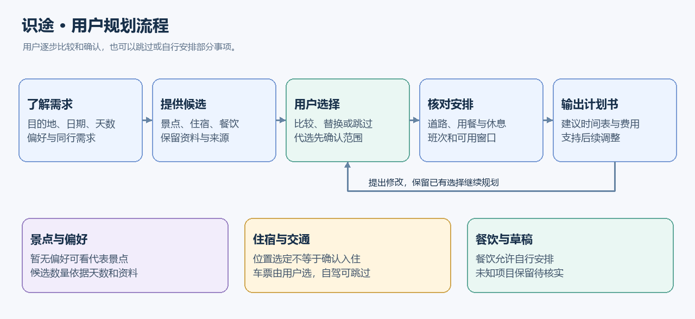
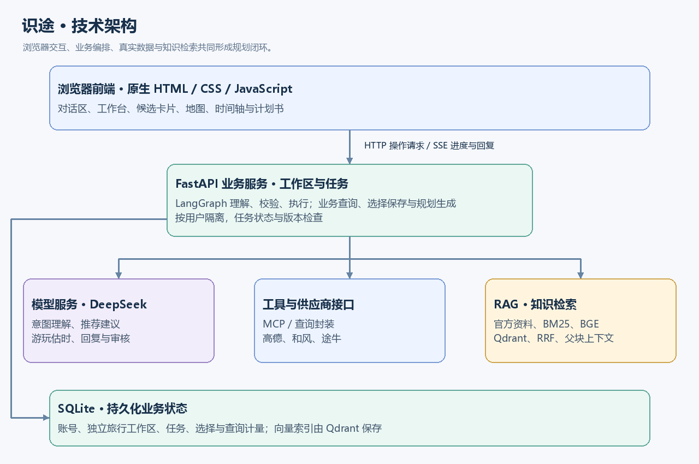
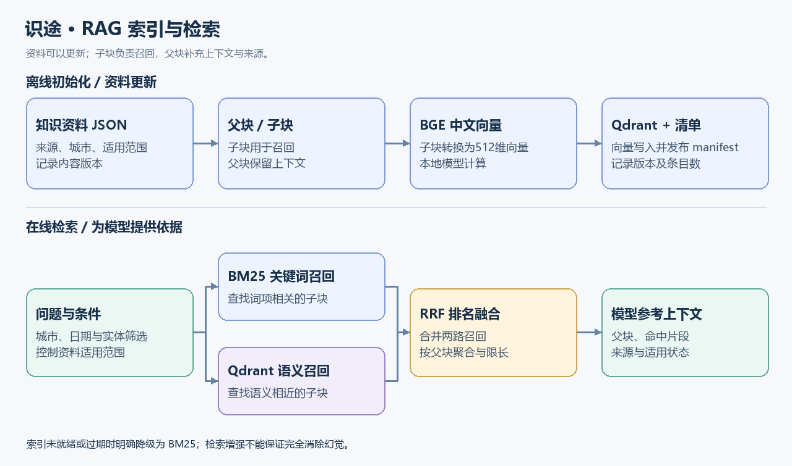
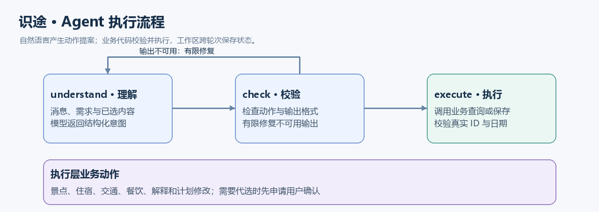
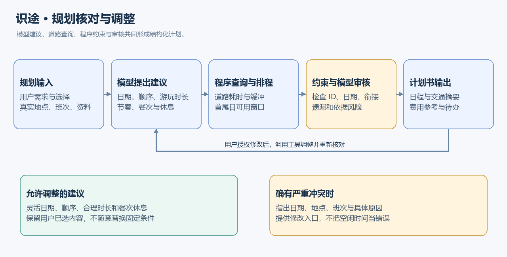

# 识途 · AI 旅行规划智能体——项目汇报

> 本稿在初稿基础上调整汇报顺序，并校正与当前实现不一致的表述。主汇报介绍背景、目标、功能与价值；原第三部分“技术栈与实现”移至最后，按三人的技术主题分别汇报。姓名可按实际分工替换。

| 汇报内容 | 建议分工 | 重点 |
|---|---|---|
| 第一至第三部分：主汇报 | 主讲人统筹，三人共同准备演示 | 为什么做、解决什么问题、用户怎么用、当前成果与边界 |
| 第四部分 4.1 | 汇报人一：数据与知识服务 | MCP、数据接口、BGE、Qdrant 与 RAG |
| 第四部分 4.2 | 汇报人二：Agent 与业务系统 | FastAPI、LangGraph、DeepSeek、存储与前端交互 |
| 第四部分 4.3 | 汇报人三：推荐与行程规划 | 推荐依据、动态时间轴、路线衔接、冲突检查与计划书 |

---

## 第一部分：项目介绍与目的

### 1.1 项目背景

自由行规划需要同时查阅景点介绍、酒店位置、交通班次、地图路线、餐饮和天气。信息分散在多个平台，用户不仅要查“有什么”，还要判断“适不适合我”“能不能顺路”“当天时间够不够”。当出发或返程时间变化时，原有安排往往还需要重新核对。

大语言模型能够理解自然语言，也能组织攻略文字。但如果只依赖模型已有知识，缺少资料检索、接口查询和约束检查，就容易出现信息过时、价格依据不明、路程未计算等问题。**一份看起来完整的攻略，并不等于一份已经核对过的行程。**

### 1.2 项目简介

**识途**是一个面向自由行用户的交互式 AI 旅行规划系统。它将需求理解、旅游资料检索、数据接口调用和结构化行程生成连接起来，让用户能够在对话中逐步比较、选择和调整。

用户可以完成“确定目的地 → 比较景点 → 选择住宿 → 安排交通与餐饮 → 生成计划书”，也可以直接提出当前最关心的问题。工作台步骤提供引导，用户仍可查询其他内容，或选择自行安排部分事项。

系统输出包括每日建议时间表、交通方式与预计耗时、住宿和餐饮选择、费用参考、天气信息，以及出发前待办。资料和查询结果保留来源；未知或估算内容明确标注。

### 1.3 做这个项目的目的

**核心问题：让 AI 旅游推荐更接近实际决策和出行准备。**

例如，规划“青岛三日游”时，仅列出几个景点还不够：

- 景点开放、门票和预约要求是否有依据？当前资料能否适用于出游当天？
- 住宿到景点、景点到餐厅之间需要多久？是否存在明显折返？
- 中午或下午才抵达时，首日安排是否仍有足够时间？
- 预算中哪些来自查询报价，哪些只是参考，哪些尚未取得数据？
- 用户想放慢节奏或调整一天的安排时，如何保留已选内容继续修改？

识途的目标是：**让 AI 从“直接生成攻略文字”走向“结合真实资料和用户选择进行规划”。**

具体目标分为三层：

1. **数据可信、依据可追溯**：优先使用官方知识资料和接口返回结果，保留来源与查询时间，区分事实、建议和未知。
2. **交互完整、决策可调整**：支持比较、替换、跳过和自然语言修改，保留用户已有选择。
3. **计划便于执行与复核**：将日期、活动、道路耗时、休息和待办组织成结构化计划书；对尚未核实的条件保留草稿说明，不承诺出游当天一定可行。

---

## 第二部分：项目展示

### 2.1 整体界面

识途是一个 Web 应用，通过浏览器使用。界面主要分为两栏：

- **左侧对话区**：描述旅行需求、询问原因、提出修改；查看处理进度、具体问题和修改入口。
- **右侧工作台**：展示景点、酒店、交通、餐饮、天气、地图与计划书，便于比较和选择。

此外，旅行时间轴展示当前建议安排、出行方式和预计耗时。每次查询与选择围绕独立的旅行工作区保存，便于回来继续规划。

### 2.2 核心使用流程

*图 1：典型使用流程。步骤可以按用户需求调整；住宿、城际车票和餐饮不强制全部选择。*

以“想去青岛玩三天”为例：

1. **了解需求**：记录目的地与天数；没有旅行偏好时，询问海滨、人文、自然、亲子或慢节奏等方向。用户明确暂无偏好，也可直接查看代表景点。
2. **比较景点**：结合天数、偏好、同行需求及可用资料提供候选。当前基础目标为每天至少两个候选，例如两天四个、三天六个；数据或定位条件不足时如实说明。候选和备选不等于全部必须游玩，也不会默认选中前四个。
3. **比较住宿**：根据已选地点及逐晚安排查询酒店，展示位置和价格参考。选定住宿位置即可继续，房型可选；入住时刻由用户自行安排或先与助手讨论，不默认写入晚上入住。
4. **安排交通**：展示去程、返程班次的时间、时长和参考价格；车票、机票由用户明确选择。自驾或自行安排往返时，可以跳过城际票选择。
5. **安排餐饮**：可以按日期、餐次选餐厅，也可以自行安排。酒店含早等信息有依据时才用于规划。
6. **生成并调整计划书**：核对道路、日期和固定条件，生成每日建议安排。用户可继续提出调整，助手在授权范围内调用工具修改。

**各步骤的展示重点：**

| 步骤 | 展示形式 | 特色 |
|---|---|---|
| 景点选择 | 推荐卡片、详情、地图与候选分页 | 根据天数和偏好获取候选，支持继续推荐；未入库地点明确提示 |
| 住宿选择 | 酒店卡片、逐晚住宿编排 | 选定位置即可继续；房型可选，入住时刻不默认确定 |
| 交通选择 | 班次对比卡片 | 用户自行确认；支持自驾与自行安排 |
| 餐饮选择 | 日期与餐次对应的餐厅卡片 | 展示人均消费等已有参考；允许自行安排 |
| 时间轴 | 活动、休息、交通方式与预计耗时 | 支持核对道路及调用调整工具，避免固定时间占位 |
| 计划书 | 结构化页面、打印与 Markdown 导出 | 汇总日程、费用参考、天气、来源和待办 |

### 2.3 计划书内容

最终计划书主要包括：

- **旅行条件**：目的地、日期、天数、人数、预算与旅行节奏。
- **已选住宿**：酒店位置、逐晚选择和房型信息（如有）；选定不代表已经预订。
- **用餐安排**：餐厅选择或自行安排，保留日期与餐次。
- **往返交通**：已选班次或自驾、自行安排的说明；未知抵达时间不会假定为全天可用。
- **每日安排**：活动顺序、建议起止时间、游览时长、午休与机动时间，以及交通方式和预计耗时。
- **费用参考与未知费用**：已有报价、参考估算和待核实项目分别展示，不将缺失费用当作零。
- **天气**：展示接口实际覆盖的预报日期；当前预警不等于未来出游日预警。
- **出发前待办与风险**：预约、开放、报价、交通及入住条件等需要进一步确认的事项。
- **携带建议**：结合已取得的天气、活动及同行需求提出建议。

交通展示侧重“怎样过去更合适、预计多久、费用参考多少”，不展开逐段转弯、上下车等导航说明。实际出行仍需结合实时导航和现场情况。

### 2.4 自然语言交互与演示建议

用户不需要记住固定命令，可以表达目标，例如：

- “想轻松一点，多推荐几个海边的景点。”
- “不吃海鲜，帮我比较其他餐厅。”
- “返程推后一天，保留已经选的景点。”
- “下午才到，帮我看看第一天会不会太赶。”
- “入住我自行安排。”
- “帮我调整一下时间轴，留出午休。”

系统先理解请求，再执行查询、保存选择或提出建议。自动代选会先确认决定范围，车票和机票仍由用户自行确认。修改涉及未入库地点或固定条件冲突时，说明具体原因和可修改位置。

回复以回应当前请求为主，说明结果、原因或缺项，不要求每次都按固定模板说“下一步”。演示建议选择一个已有资料的目的地，展示“查询—选择—修改—生成”的完整闭环。

---

## 第三部分：解决的痛点、项目价值与当前边界

### 3.1 解决的痛点

| 痛点 | 仅生成攻略文字时的常见不足 | 识途的处理方式 |
|---|---|---|
| 信息可能过时 | 景点、开放和预约信息缺少明确出处 | 结合官方资料和地图信息，保留来源、查询时间及适用范围 |
| 路程没有计算 | 活动之间只写“前往”，缺少真实耗时 | 查询道路方案，将交通时间与合理缓冲纳入衔接 |
| 首尾日安排不合理 | 抵达日、返程日也按完整游玩日处理 | 结合已确认班次、接驳准备与日期计算可用窗口 |
| 推荐不够个性化 | 很少结合偏好、同行人群和旅行节奏 | 将明确需求、地点资料和有效天气提供给模型共同判断 |
| 费用口径不清楚 | 总预算缺少明细或混用人均、单人和全程价格 | 展示已有价格参考，标注费用口径，列出尚未核实项目 |
| 生成后难以调整 | 修改请求与现有选择缺少衔接 | 保存工作区状态，按授权调用调整工具并重新核对 |
| 出发准备容易遗漏 | 攻略只列景点，没有待办 | 汇总预约、交通、天气、入住和携带事项 |

### 3.2 功能取向对比

以下是方案功能取向的比较，不是对所有商业产品的实测排名。通用助手接入搜索或工具后，也能够获得外部数据；识途的重点在于将这些能力组织为专门的旅行规划闭环。

| 对比维度 | 通用对话式规划（未接入专用工具时） | 常规旅游信息检索 | 识途原型 |
|---|---|---|---|
| 数据组织 | 以模型回答为主 | 用户分别查看地点、住宿和交通 | 官方资料与接口结果共同进入规划上下文 |
| 规划方式 | 容易一次性输出文字 | 用户自行整理日程 | 对话引导、候选比较、确认与调整 |
| 时间与道路 | 可能只有概括描述 | 可查单段路线，但需手动串联 | 核对活动间道路、用餐、休息和首尾日窗口 |
| 费用说明 | 需要另外追问依据 | 多个平台分别展示报价 | 汇总参考口径，明确列出未知项 |
| 调整方式 | 通过再次对话修改描述 | 手动修改各项选择 | 保留选择状态，调用业务工具调整并复核 |
| 输出成果 | 对话文字 | 收藏或订单等平台内容 | 可继续完善的结构化旅行计划书 |
| 资料追溯 | 取决于是否接入检索与引用 | 各平台提供自身资料 | 检索及查询结果保留来源和时间信息 |

### 3.3 核心优势

1. **资料增强决策**：用 RAG 检索补充官方上下文，降低缺少依据的生成风险。
2. **工具连接真实数据**：通过统一工具与供应商封装使用地点、路线、天气、酒店和班次信息。
3. **多轮规划与选择保留**：围绕工作区持续修改，查询和解释不强制变成重新配置。
4. **约束核对与动态调整**：把用户选择、班次、道路、餐次和休息连接起来，支持工具调整时间轴。
5. **清楚表达不确定性**：区别查询事实、规划建议和未知条件，不把估算包装为保证。

### 3.4 当前成果与边界

当前原型已覆盖对话、候选比较、逐晚住宿、交通与餐饮安排、地图、时间轴、规划审核及计划书导出。知识与目的地目录目前覆盖20个城市；覆盖城市不代表该城市所有景点、酒店或未来日期均有完整数据。

仍需明确的边界包括：

- 接口结果是查询时快照，地图资料不能保证出游当天开放，列表报价不能保证最终可售或预订成功。
- 天气受预报窗口限制，超出窗口的日期保留未知。
- 游玩时长、休息和机动属于建议，受现场排队、体力和道路状况影响。
- 费用汇总目前以已有参考和未知项说明为主，尚未完成围绕总预算的综合消费优化。
- 当前整合版本使用 SQLite 和本地持久化 Qdrant；MySQL、独立 Worker 等平台升级不列为本稿已实现成果。
- 已有模型审核步骤与工具调整机制，但不将其描述为已经部署完整多 Agent 协作系统或实现全局最优路线。

**主汇报收束：**识途尝试把分散的信息查询、用户决策与行程核对连成完整流程。项目价值在于让旅行计划更有依据、更容易修改，也更清楚地展示尚需确认的条件。

---

## 第四部分：三人分别汇报技术栈与实现

> 本部分对应初稿第三部分，统一移至主汇报最后。三人围绕同一条链路讲解：数据与依据如何取得 → 用户请求如何变成业务动作 → 动作结果如何组成并核对行程。

### 技术架构总览

*图 2：当前整合版本。浏览器通过 HTTP 提交操作，使用 SSE 接收任务进度与回复；后端连接业务状态、模型、工具与知识检索。*

### 4.1 汇报人一：数据与知识服务

**这一部分主要回答：模型用于规划的信息从哪里来，如何保证来源和上下文可追溯？**

#### 4.1.1 数据来源与查询封装

- **高德地图**：地点搜索、坐标与详情、车站和机场候选、道路方案及预计耗时。
- **和风天气**：实际覆盖日期的预报与当前预警；查询失败和没有预警分别处理。
- **途牛 MCP 服务**：酒店、房型、门票、火车及机票等服务，返回结果保留报价条件和查询来源。
- **官方知识资料**：在 `data/knowledge/*.json` 中保存旅游介绍、适用范围和来源，供检索使用。

地点进入推荐前需要核对可用坐标；无法定位、匹配不明确或仅为辅助设施的结果不直接作为正常游玩候选。未入库地区或指定景点会明确提示数据暂时缺失，不用模型自行补造。

供应商封装还负责参数校验、结果格式、缓存与调用计量。相同可复用查询优先利用缓存；途牛多账号按可用状态轮换，每个账号继续保留独立的间隔、额度和冷却记录。减少等待不等于保证单次接口更快。

#### 4.1.2 MCP：标准化工具接口

MCP（Model Context Protocol）提供模型应用连接工具和数据的统一协议。识途将本地数据能力注册为工具，业务层按名称和参数调用，降低查询逻辑与规划逻辑的耦合。

当前本地 MCP 工具包括：

| 工具名 | 功能 | 来源或实现 |
|---|---|---|
| `search_places` | 搜索景点、酒店、餐厅等地点 | 高德地图 |
| `get_spot_candidates` | 从已覆盖地点获取每批最多4个景点候选 | 覆盖目录与高德定位 |
| `get_place_details` | 获取已有地点详情 | 高德地图 |
| `search_transport_places` | 查询车站、机场及接驳候选 | 高德地图 |
| `calculate_route` | 查询步行、驾车、公共交通道路方案 | 高德地图 |
| `daily_weather` | 查询天气预报及当前预警 | 和风天气 |
| `retrieve_guides` | 检索旅游知识与官方上下文 | RAG |
| `knowledge_status` | 查看知识与索引状态 | 本地资料与索引清单 |

途牛供应商工具通过相应服务封装调用，不能将火车、机票查询统一说成来自高德。模型的业务动作与本地 MCP 工具也分属不同层，例如“查询住宿”会组织供应商查询、位置匹配和候选保存。

选择这种组织方式，是为了便于独立测试、统一处理来源和错误，并让新增工具不必改写整个对话流程；仍需要为新工具补充业务适配与验证。

#### 4.1.3 Qdrant、BGE 与 RAG

**Qdrant**保存文本向量并支持相似度查询；**BGE（`BAAI/bge-small-zh-v1.5`）**把中文文本转换成512维向量，当前通过 FastEmbed 与 ONNX Runtime 本地运行。

*图 3：索引需要初始化，资料或模型配置变化后可重新构建；不是只运行一次就永久有效。*

**索引构建流程：**

1. 读取已有知识 JSON，检查来源、城市、适用范围与内容版本。
2. 拆成父块和子块：子块用于召回，父块保留更完整的上下文。
3. 对子块生成中文向量并写入 Qdrant。
4. 发布索引清单 `manifest`，记录语料版本、模型身份、条目数和生成时间。

**在线检索流程：**

1. 按城市、日期及已有实体条件筛选可用资料。
2. 使用 BM25 进行关键词召回，同时查询 Qdrant 获得语义召回。
3. 用 RRF（倒数排名融合）合并两路排序，按父块聚合并控制上下文长度。
4. 将命中片段、父块上下文、来源和适用状态交给模型。

当前资料规模为116条原始记录、125个父块、350个子块，后续会随资料更新变化。没有初始化、索引过期或向量服务异常时，系统明确降级为 BM25，不将旧向量结果冒充最新检索。

**为什么这样选型？**

- RAG 让模型能够参考已保存的资料，更新资料时无需重新训练生成模型；它可以降低无依据生成的风险，但不能保证完全消除幻觉。
- Qdrant 支持本地持久化，便于原型部署，也可配置服务端；当前不宣称经过与 Chroma 的系统性性能比较。
- BGE 支持本地中文向量计算，减少额外 Embedding API 依赖；初次下载、硬件与维护仍有成本。
- 父子块组合兼顾召回精度和上下文完整性，避免只返回脱离适用条件的一句话。

**本部分收束：**数据模块提供带来源、适用范围和未知状态的事实输入，供后续 Agent 理解与规划使用。

### 4.2 汇报人二：Agent 与业务系统

**这一部分主要回答：自然语言请求如何变成可执行动作，系统怎样保存状态并展示结果？**

#### 4.2.1 FastAPI：后端服务与任务接口

FastAPI 提供异步 Python Web 服务，挂载前端静态资源，并接收用户操作。核心入口为 `/api/workspaces/{wid}/actions`，处理聊天、查询、选择和规划等动作。

- 请求校验后创建任务，浏览器通过 SSE 接收进度和分段回复。
- 工作区操作进行互斥与版本检查，避免并发修改覆盖已有选择。
- 支持任务状态、取消、失败提示和恢复入口；按用户隔离访问。
- 可以对相互独立的外部查询并行处理，但仍受供应商间隔、额度和网络时延约束。

选用 FastAPI，是因为异步请求、结构化校验和 Python AI 生态适合当前场景。异步有助于减少可并行请求的串行等待，不意味着每次规划都能立即完成。

#### 4.2.2 LangGraph：理解、校验、执行

*图 4：当前 LangGraph 的主要节点是 `understand → check → execute`。景点、住宿、交通等是执行层的业务动作，不分别等同于图中的独立节点。*

- **理解**：结合本轮消息、旅行条件和已有选择，让模型返回结构化意图与动作。
- **校验**：检查动作和输出是否可用；不合格输出进行有限修复，避免无限重试。
- **执行**：由业务代码调用对应查询或保存逻辑，校验真实候选 ID、日期与修改权限。

多步目标还会结合工具观察继续判断；解释、查询、保存用户指定选择和自动代选具有不同的决定权。需要代选时先申请用户确认，不把一次查询等同于授权重新选择整趟旅行。

LangGraph 负责组织执行流程；跨轮次状态由工作区和存储模块保存，两者配合使用。其价值在于可追踪的节点、条件分支和清楚的输入输出，方便定位意图错误与业务错误。

#### 4.2.3 DeepSeek：理解与建议生成

大语言模型用于意图理解、推荐理由、游玩时长和安排建议，以及回复与审核。接口和模型名称按配置使用，业务不会依靠模型记忆确认票价、路线或当天开放情况。

模型返回的是动作提案或规划建议，程序负责执行与校验。面向用户的回复支持流式显示，任务过程也可通过 SSE 更新；外部查询仍可能需要等待，不保证输入后立即出现完整结果。

选择模型主要考虑中文交互、结构化工具调用和原型接入成本。本稿不作未测量的模型能力排名或实时价格比较。

#### 4.2.4 SQLite：工作区与任务状态

当前整合版本用 SQLite 保存账号、旅行工作区、任务与查询计量等数据。每个工作区保留需求、景点、逐晚酒店、班次、餐饮、计划书和相关状态，支持回来继续规划和版本恢复。

SQLite 的部署要求较少，适合当前单机原型。用户隔离、事务和版本检查由业务实现；它不等同于已经完成 MySQL 或独立 Worker 升级。正在使用的数据库需要一致性备份，不能只复制主文件就假定所有写入均已保存。

#### 4.2.5 原生 HTML、CSS 与 JavaScript：交互界面

当前前端仍使用原生 HTML、CSS、JavaScript，尚未迁移为 Vue。

- `index.html`组织页面与弹窗；`account.js`处理账号与旅行列表。
- `app.js`处理基础交互；`workbench.js`、`details.js`、`experience.js`等扩展工作台、详情与时间轴。
- `interactive-map.js`处理地图交互；样式分布在 `style.css`、`workspace.css`、`product.css`。

早期原生方案便于直接接入后端和快速验证。随着功能增加，全局状态和渲染函数耦合也成为维护成本；因此不将“完全不需要复杂状态管理”作为优势。后续可按实际需要进行组件化，当前汇报应按已实现技术说明。

**本部分收束：**业务系统将用户请求、模型提案、工具结果和持久化状态连接起来，提供可操作、可恢复的旅行工作台。

### 4.3 汇报人三：推荐与行程规划

**这一部分主要回答：取得候选和用户选择后，怎样形成比较合理、可调整的每日安排？**

#### 4.3.1 推荐依据与候选数量

推荐综合用户明确偏好、游玩天数、同行需求、地点范围和位置，以及有效日期的天气。模型可以估计体验范围与合理停留时长；开放、费用和道路信息仍以提供的资料为依据。

景点按每批最多四个查询，业务在数量不足时继续获取，直到达到本轮目标或已有资料耗尽。模型排名影响顺序，不应因只给一个排名就删除其他有效候选。大型景区与小景点不按统一时长安排，候选数量也不等于最终必须去的数量。

无偏好推荐目前主要参考城市代表景点资料和地图评分，**不是已实现实时景点热度榜**。父景区与已选子地点通过明确关系处理，避免重复推荐、重复占用时间。

#### 4.3.2 时间轴、道路与休息

*图 5：模型提出安排建议，程序核对真实道路和固定条件，再进行规划审核；用户授权后可调用调整工具。*

每日安排需要同时考虑：

- **首尾日窗口**：班次抵达、出站接驳、候车或值机准备；未知时间不会按零处理。
- **活动时长**：景点规模、游览范围、拍照与慢行、同行体力，不统一套固定分钟数。
- **实际道路**：住宿到景点、景点到餐厅、活动之间及住宿返回的方式与耗时。
- **餐次与休息**：午餐、午休、短暂休息和机动时间分别计算，不能通过删除休息掩盖时间不足。
- **用户固定选择**：明确日期、时段、顺序和班次优先保留，无法满足时说明具体冲突。

住宿按夜晚选择，早晨和当晚可能对应不同酒店。模型可结合当天收尾地点推荐住宿；选定位置不代表已经确认房型或入住时刻。

#### 4.3.3 工具调整与冲突分级

用户要求“放慢节奏”“重新分配”或“调整时间轴”时，助手可以调用 `adjust_timeline`，调整未固定的日期、活动顺序、合理游玩时长和餐次休息建议。修改后再核对路线和固定条件，已有景点、酒店、餐厅及班次选择不能被随意替换。

普通负担不均、稍晚或可通过调整解决的问题，优先提供可用安排；严重影响固定班次、日期或可用窗口的冲突，明确指出日期、相关地点与原因，并提供修改入口。警告与阻止分开处理，不把“还有空闲时间”当作必须填满的错误。

#### 4.3.4 程序检查与模型审核

规划先检查候选身份、日期、重复安排和时间衔接，再由模型审核是否遗漏用户要求、混淆事实与建议，或仍有明显风险。

审核步骤承担独立角色，但仍属于当前业务调用流程，不宣称已经运行完整的多 Agent 团队。模型审核失败时保留程序检查结果并提示人工复核，不将失败当成“审核通过”。

#### 4.3.5 计划书输出与费用口径

计划书由结构化日程、选择状态、费用参考、天气和来源等数据组成，前端展示与 Markdown 导出使用这些结果。

- 道路展示交通方式、预计耗时、距离与已有费用参考，不展开逐段导航。
- 酒店起价、餐厅人均、单人票价和整段费用明确区分；费用未知不写成零。
- 选定酒店、车票和景点仅用于规划，不等同于下单、出票或预约成功。
- 计划作为可继续完善的草稿，保留出发前待办与需要再次核实的条件。

**本部分收束：**行程规划的关键是让模型的建议与真实数据、用户决定和程序校验共同作用，形成更容易使用和修改的旅行计划书。
